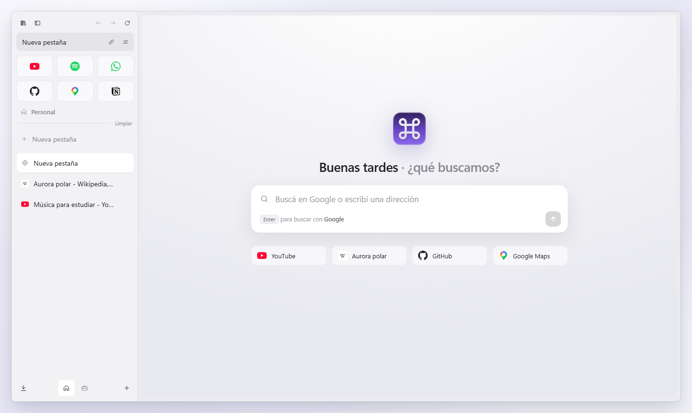

<p align="center">
  
</p>

<h1 align="center">Beauty Browser</h1>

<p align="center">A simple, beautiful browser for Windows, built on Chromium.</p>

<p align="center">
  <a href="https://github.com/fabriciovla/BeautyBrowser/releases/latest"></a>
  <a href="https://github.com/fabriciovla/BeautyBrowser/actions/workflows/build.yml"></a>
  <a href="LICENSE"></a>
</p>

<p align="center">
  
</p>

## Features

- **Tabs on the side.** A glass sidebar that slides in when the mouse reaches the left edge, or stays pinned.
- **Spaces.** Separate groups of tabs, each with its own icon, like Arc.
- **Favorites.** Pinned sites with their own tab, one click away at the top of the sidebar.
- **Peek.** Links that would open a new tab show in a mini window over the page first.
- **Tab switcher.** Ctrl+Tab shows your tabs with thumbnails before switching.
- **Built-in ad blocker.** uBlock Origin's filter lists and scriptlets, compiled and injected natively.
- **Command palette.** Ctrl+T searches open tabs, history and Google suggestions.
- **Real Chromium.** Sites work as they do in Chrome, DevTools included.
- **English and Spanish,** following the Windows display language.

## Download

Get the installer from the [latest release](https://github.com/fabriciovla/BeautyBrowser/releases/latest). It installs
for the current user, without administrator rights, on Windows 10 version 2004 or later and Windows 11 (x64).

## How it works

Beauty Browser is a C# app with a WinUI 3 interface. The engine is Chromium through CEF and CefSharp, rendered
offscreen: Chromium hands every frame over as a shared GPU texture, which is composited into the window without
touching the CPU. The UI never talks to Chromium directly; everything goes through `BeautyKit`.

```
src/
  BeautyBrowser/   WinUI 3 app: window, sidebar, library, settings and onboarding
  BeautyKit/       Engine layer: tabs, rendering, input, DevTools and the content blocker
installer/         Per-user installer (WPF) and the script that builds it
tools/             Builds CEF with proprietary codecs
```

## Building

Requirements:

- Windows 10 version 2004 or later, or Windows 11 (x64)
- [.NET 10 SDK](https://dotnet.microsoft.com/download)

```powershell
dotnet build BeautyBrowser.slnx
dotnet run --project src/BeautyBrowser
```

To build the installer (`artifacts/BeautyBrowserSetup.exe`):

```powershell
powershell -File installer/build-installer.ps1
```

### Video codecs

The CEF binaries on NuGet ship without proprietary codecs, so H.264 and AAC media (live streams, many social sites)
does not play. `tools/build-cef-codecs.ps1` builds the same CEF version with codecs into `third_party/cef-codecs`,
and the app build picks those binaries up automatically. It needs about 100 GB of free disk space and several hours.

```powershell
powershell -ExecutionPolicy Bypass -File tools/build-cef-codecs.ps1
```

## Data

Everything stays on your PC, in `%LOCALAPPDATA%\BeautyBrowser`: the Chromium profile, history and settings
(SQLite), favorites, downloads and the blocker's filter lists.

## Contributing

Issues and pull requests are welcome. See [CONTRIBUTING.md](CONTRIBUTING.md).

## License

[MIT](LICENSE)
